# 灵感小组件

原生 Android 桌面小组件与动效应用。**无需注册、无需登录，打开即用，核心功能离线运行。**

[下载 Android APK · v1.4.0](https://github.com/Lpkiki/widgetstudio-showcase/raw/refs/heads/main/apk/WidgetStudio-1.4.0.apk) · [查看版本说明](CHANGELOG.md)

本仓库提供安装包、效果截图和使用说明。Android 源码单独保存在私有仓库，本仓库不包含源码。

## 安装与使用

1. 下载 APK，按照 Android 系统提示安装后打开。
2. 选择喜欢的小组件，调整图片、样式或背景，保存并添加到桌面。
3. 若桌面未弹出添加窗口，可长按桌面空白处 → 小组件/应用挂件 →「灵感小组件」手动添加。
4. 桌面宠物、贴纸、氛围灯和充电效果按需请求悬浮窗与通知权限，可在应用内关闭。

版本 **1.4.0**，测试体验包（debug 签名）。最低 Android 8.0 / API 26；本轮核心验收使用 Android 15 真机，不保证所有厂商桌面和系统版本表现完全一致。

## 小组件与动效

| 电子吧唧 | 趣味空调 | X 面板 |
| :---: | :---: | :---: |
| 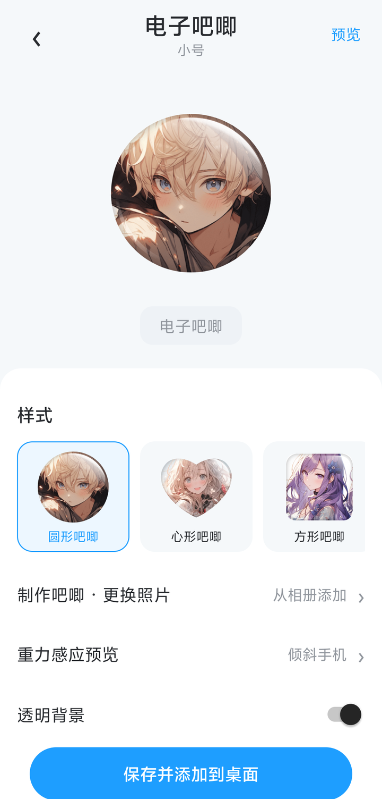 | 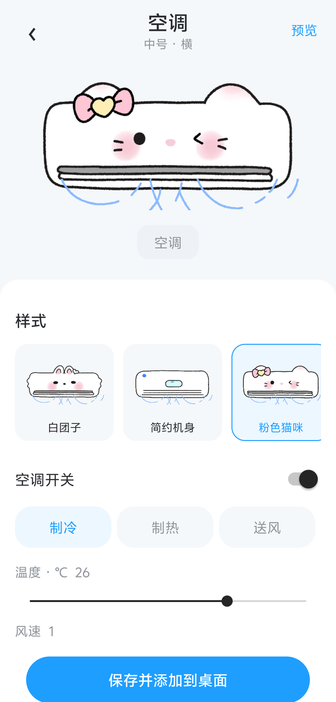 | 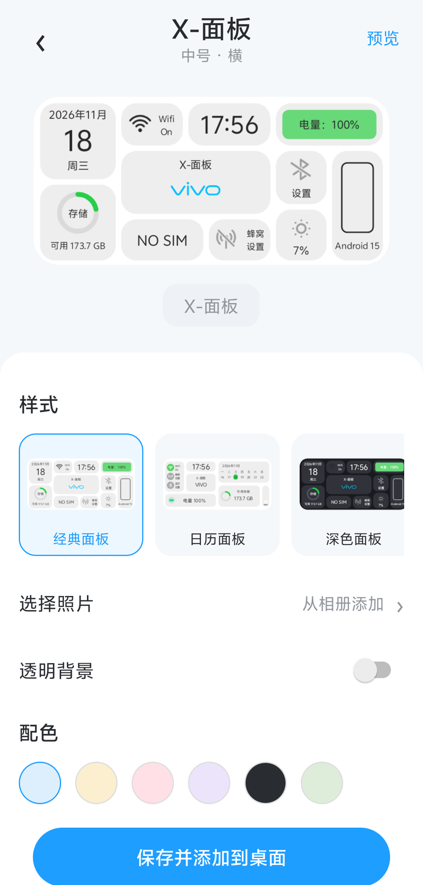 |
| 自定义照片、形状与倾斜互动 | 开关、调温与模式切换；不控制真实家电 | 时间、电量、存储和系统设置入口 |

| 照片面板 | 重力感应图标 | 桌面宠物 |
| :---: | :---: | :---: |
| 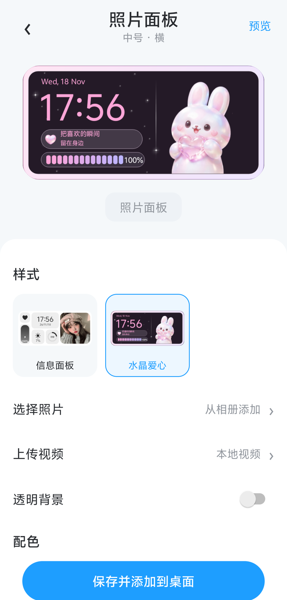 | 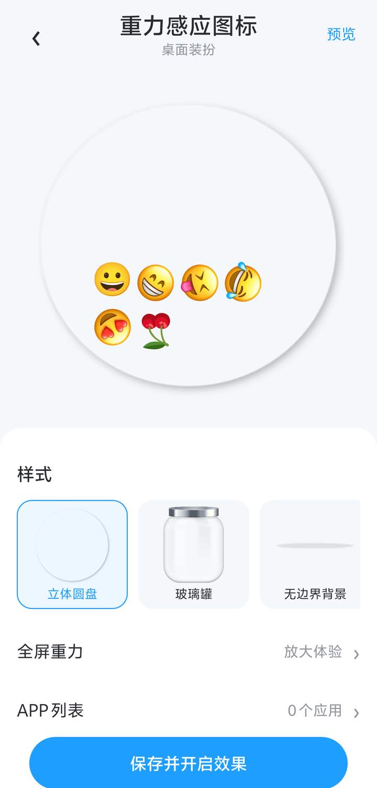 | 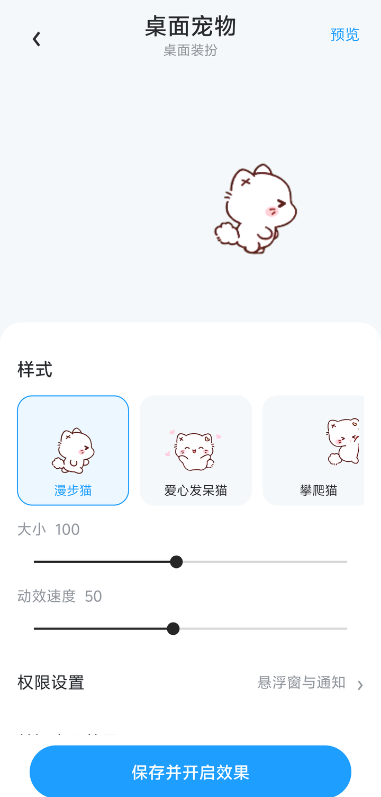 |
| 本地照片、视频预览与透明背景 | 图标/表情、传感器与碰撞互动 | 行走、攀爬、拖动和关闭 |

| 状态贴纸 | 氛围灯 | 充电特效 |
| :---: | :---: | :---: |
| 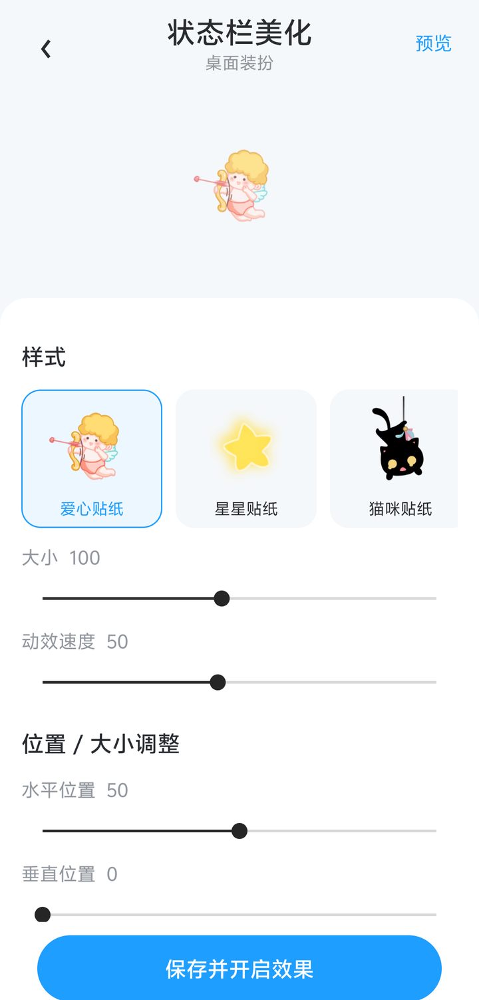 | 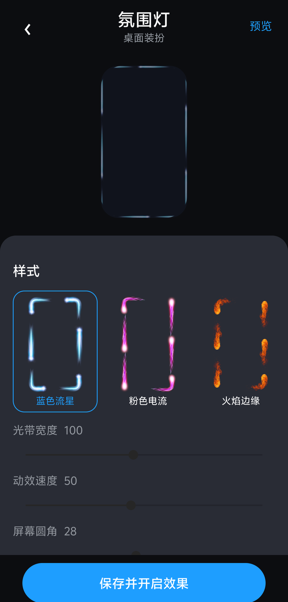 | 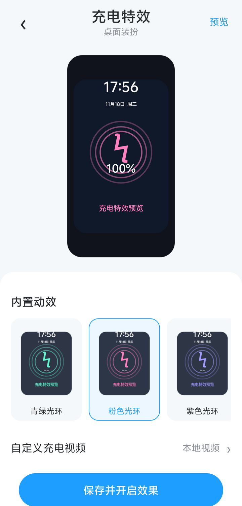 |
| 调整大小、位置、旋转和透明度 | 动态边缘、圆角与仅充电显示 | 内置光环、本地视频、时间与电量 |

以上为 **1.4.0 当前版本真机截图**，主要展示编辑页及预览。动态效果在截图中呈现为静态帧。另有主题、壁纸及桌面快捷图标功能。

## 桌面透明效果

PNG 图片的透明通道会保留；开启透明背景后，桌面壁纸可透过卡片背景和图片透明区域。信息卡、文字和边框仍保留各自样式。

| 照片面板：透明 PNG 与背景 | X 面板：信息卡之间透出壁纸 |
| :---: | :---: |
| 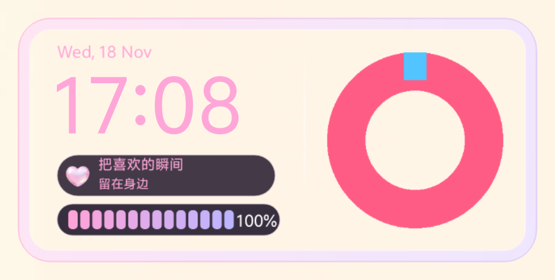 | 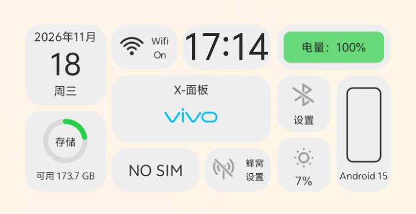 |

粉环是透明通道验证用的示例图片。旧版本中已被转成 JPEG 的透明图片，需要重新导入一次。

## 使用范围

- 照片桌面组件中的视频显示封面，在应用内预览播放；导入 GIF/WebP 动图目前取静态画面。
- 状态贴纸不替换系统时间、信号等系统状态栏内容。
- 充电效果主动开启后，在亮屏解锁状态下触发，点击可关闭本次动画；不主动唤醒锁屏。
- 内置充电光环为本项目动效，也可使用本地视频；不提供在线素材库。
- 桌面表现受启动器、系统权限和后台策略影响。

## 安装包校验

文件：`apk/WidgetStudio-1.4.0.apk`

SHA-256：

```text
95b693451254bb6221e3d28365ccd91ab0635c49889603d54cb9391791175f72
```

校验文件见 [SHA256SUMS.txt](SHA256SUMS.txt)。
